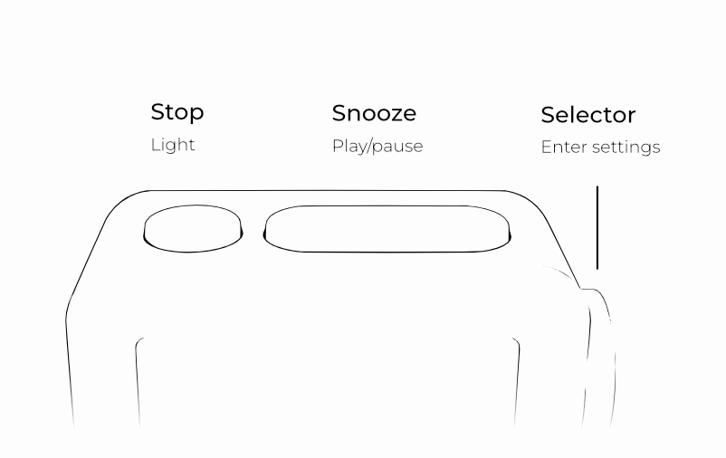

# Controls

Learn about the different controls on your bedside clock. 

<ClockControls />

## Turning on the display light

Any interaction with the clock will turn on the display light for 10 seconds.

## Reboot

Next to the USB-C port on the back of the bedside clock you will find a small pinhole. This is the reboot button. Press it once to reboot the clock. This does not reset or delete any settings.