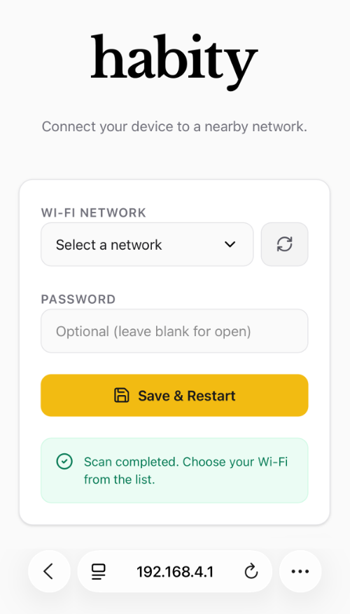

# WLAN-Funktionen
Verbinde deinen Wecker mit deinem WLAN zu Hause, um Funktionen wie die automatische Einstellung von Datum & Uhrzeit, Firmware-Updates und die Verbindung mit deinem Smart Home zu nutzen.

## WLAN über den Computer einrichten
Du kannst das WLAN auf [connect.habity.design](https://connect.habity.design) einrichten.

1. Verbinde deine Uhr mit einem USB-Kabel mit deinem Computer.
2. Öffne connect.habity.design in deinem Browser.
3. Wähle dein WLAN-Netzwerk aus und folge den Anweisungen auf dem Bildschirm.

  <a class="hb-cta" href="https://connect.habity.design" target="_blank" rel="noopener">Zu connect.habity.design</a>

## WLAN über das Handy einrichten

Folge den Anweisungen unten, um die Uhr mit deinem Handy mit dem WLAN zu verbinden.

  <iframe
    style="position: absolute; top: 0; left: 0; width: 100%; height: 100%;"
    src="https://www.youtube.com/embed/0_d7GMbif8M"
    title="YouTube video player"
    frameborder="0"
    allow="accelerometer; autoplay; clipboard-write; encrypted-media; gyroscope; picture-in-picture; web-share"
    allowfullscreen>
  </iframe>

### Ersteinrichtung

Deine Uhr hat ein eigenes WLAN, das sie für die Ersteinrichtung verwendet. Öffne die WLAN-Einstellungen auf deinem Handy, Tablet oder Computer, suche nach „Habity setup_01234“ und verbinde dich mit diesem WLAN.

> [!NOTE] HINWEIS
> **Du siehst den WLAN-Namen nicht?** Prüfe, ob dein Wecker am Strom angeschlossen und WLAN darauf eingeschaltet ist.
>
> Geh zu „More“ > „Wi-Fi“ > „Settings“ und prüfe, ob „Wi-Fi is on“ angezeigt wird.

### Mit deinem WLAN verbinden

Wenn du mit dem WLAN der Uhr verbunden bist, geh auf der Uhr zu „More“ > „Wi-Fi“ > „Information“. Dort siehst du die Webadresse, die du in deinem Browser öffnen musst. Sie lautet zum Beispiel „habity.local“ oder <https://192.168.4.1>

Auf dieser Webseite siehst du eine Liste der verfügbaren WLAN-Netzwerke. Wähle dein WLAN zu Hause aus, gib das Passwort ein und klick auf „Save & reboot“.

> [!NOTE] HINWEIS
> Der Habity-Wecker kann sich nur mit 2,4-GHz-WLAN verbinden. Die meisten üblichen WLAN-Netzwerke zu Hause werden standardmäßig unterstützt.

### Web-Steuerung

Nachdem deine Uhr neu gestartet ist und sich mit den richtigen WLAN-Zugangsdaten erfolgreich verbunden hat, kannst du die Web-Steuerungsseite öffnen.

Auf der Web-Steuerungsseite kannst du die Firmware aktualisieren, die aktuelle Firmware-Version sehen, die Uhr mit deinem Smart Home verbinden und die WLAN-Einstellungen ändern.

Geh auf der Uhr zu „More“ > „Wi-Fi“ > „Information“, um die Adresse deiner neuen Web-Steuerungsseite zu sehen.

> [!NOTE] HINWEIS
> **Warnung im Browser** Dein Browser warnt dich möglicherweise vor dem Besuch der Webseite. Das passiert, weil deine Uhr mit keinen externen Servern kommuniziert, über die dein Browser die Herkunft prüfen könnte. Das schützt deine Privatsphäre, verwirrt aber deinen Browser.
>
> In den meisten Browsern kannst du die Warnung mit einer Option wie „Trotzdem besuchen“ oder „Unsichere Website besuchen“ umgehen.
