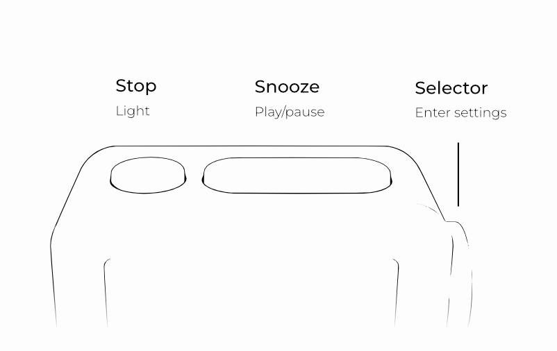

# Bedienung

Hier erfährst du, wie du deinen Wecker mit den verschiedenen Tasten bedienst. 

<ClockControls />

## Displaybeleuchtung einschalten

Jede Interaktion mit der Uhr schaltet die Displaybeleuchtung für 10 Sekunden ein.

## Neustart

Neben dem USB-C-Anschluss auf der Rückseite des Weckers befindet sich ein kleines Loch. Das ist die Neustart-Taste. Drück sie einmal, um den Wecker neu zu starten. Dabei werden keine Einstellungen zurückgesetzt oder gelöscht.
