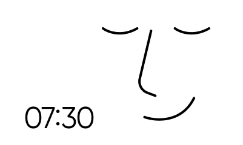

# Ruhebildschirm

Der Ruhebildschirm ist das „Gesicht“, das du siehst, wenn die Uhr 10 Minuten lang nicht berührt wurde.

Er zeigt die aktuelle Uhrzeit nur dezent an und erinnert dich daran, dich auf den ruhigen Moment zu konzentrieren.

## Ausschalten

Du kannst den Ruhebildschirm unter „More“ > „Display settings“ > „Idle screen“ ausschalten.
