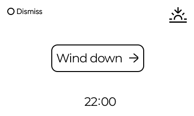

# Schlafenszeit-Erinnerung einrichten

Die Schlafenszeit-Erinnerung zeigt zur eingestellten Zeit eine Nachricht auf deiner Uhr an, damit du den Abend langsam ausklingen lässt. Du kannst dann eine Klanglandschaft abspielen oder die Nachricht schließen. 

## So richtest du sie ein

Geh zu „Wind down“, stell die Uhrzeit ein und wähle ein Geräusch aus.

Die Uhrzeit bestimmt, wann die Nachricht erscheint. Wenn du nichts tust, wird die Nachricht nach 20 Minuten automatisch geschlossen.

Das gespeicherte Geräusch ist dein bevorzugtes Geräusch. Wenn die Erinnerung aktiv ist, kannst du es abspielen oder ein anderes aus der Liste auswählen.

**Geräusche abspielen** Wenn die Nachricht erscheint, kannst du mit einem Druck auf das Auswahlrad starten.

Die Geräusche laufen höchstens 45 Minuten. Ein Alarm während der Wiedergabe unterbricht das Geräusch.

Mit der Snooze-Taste pausierst du das Geräusch.

**Schließen**:
Mit der Stopp-Taste schließt du die Nachricht.

> [!NOTE] HINWEIS
> **Tägliche Wiederholung** Alle Schlafenszeit-Erinnerungen wiederholen sich täglich, um eine regelmäßige Abendroutine zu unterstützen.
